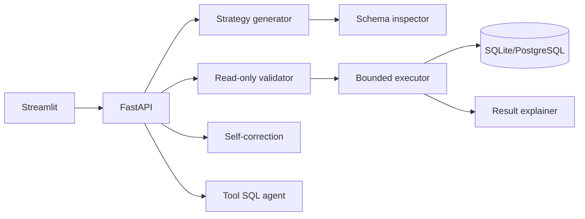

# Natural-Language-to-SQL Intelligence

A schema-aware natural-language SQL demonstrator for a university database. It supports three prompt strategies, read-only SQL validation, bounded self-correction, a tool-oriented SQL agent, result explanations, a FastAPI API, a Streamlit UI, and reproducible Spider evaluation when the official dataset is supplied.

## Quick start (offline demo)

```powershell
cd "E:\College\5th Sem\Prompt\Mini project\Natural-Language-to-SQL-Intelligence"
py -3 -m venv .venv
.\.venv\Scripts\python.exe -m pip install -r requirements.txt
Copy-Item .env.example .env
.\.venv\Scripts\python.exe scripts\setup_database.py
.\.venv\Scripts\python.exe -m unittest discover -s tests -v
```

The core demo uses SQLite so it runs without a server. PostgreSQL is supported by setting `DATABASE_URL` to a SQLAlchemy-style PostgreSQL URL and loading `database/demo_schema.sql` and `database/demo_seed.sql` into a dedicated read-only database user. Never point the demo at a production database.

## Run the interfaces

```powershell
.\.venv\Scripts\python.exe -m uvicorn app.backend.main:app --reload
streamlit run app/frontend/Home.py
```

Ollama is optional. Set `LLM_PROVIDER=ollama` and `OLLAMA_MODEL` after installing and serving a model. Without an LLM, the deterministic heuristic generator makes the included demonstration questions usable and clearly identifies itself in metadata.

## Architecture



See `docs/architecture.md`, `docs/methodology.md`, and `docs/evaluation.md` for the design and experimental protocol. Benchmark execution refuses to invent data: place an authoritative Spider `dev.json` and database directory under `evaluation/datasets/spider/`, then run `scripts/run_evaluation.py`. The script writes JSON and JSONL reports only after real execution.

## Example questions

- Which students are enrolled in Computer Science courses?
- Show the average mark by course, highest first.
- List students whose average mark is above the overall average.
- How many students are in each department?

## Testing

The test suite covers schema discovery, generation strategies, read-only safety, execution, self-correction, LangGraph agent routing, persistent history, metrics, and API behavior. Tests do not call an external LLM. Run with coverage using `py -3 -m pytest --cov=. --cov-report=term-missing`.

## Current limitations

The included offline provider is deterministic and is not a measured LLM benchmark. Set `LLM_PROVIDER=ollama` with `OLLAMA_MODEL=qwen2.5-coder:7b` for actual inference. PostgreSQL support is implemented through SQLAlchemy inspection/execution but requires a reachable server and credentials. The official Spider archive and evaluator are integrated under `evaluation/`; run the smoke command in `docs/evaluation.md` before the resumable 100-question command. The repository never fabricates benchmark results.

